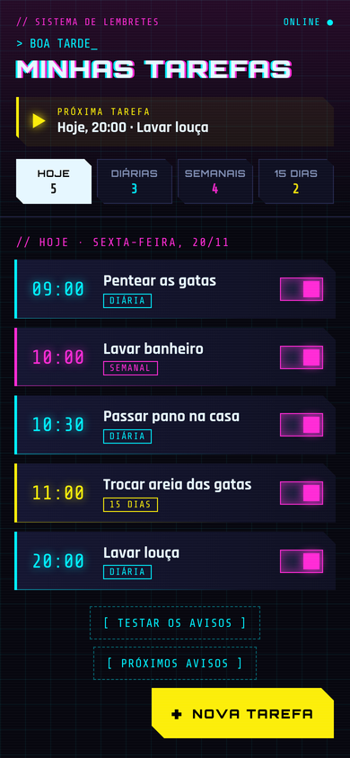
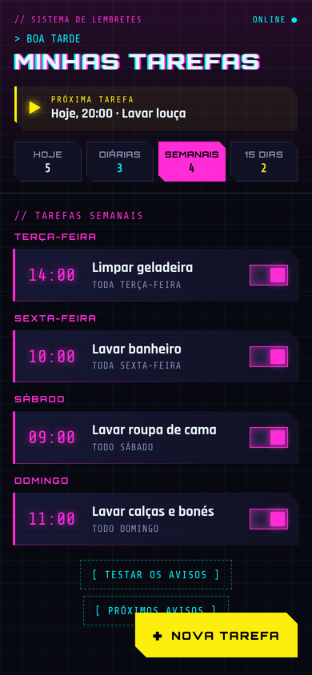
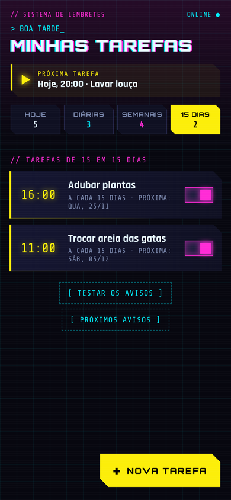
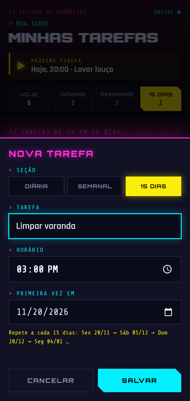
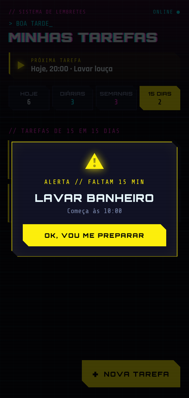

  

<h1 align="center">MINHAS TAREFAS</h1>

  <b>App Android de lembretes das tarefas da casa, com visual cyberpunk.</b> 
  Organize as tarefas diárias, semanais e de 15 em 15 dias. O app avisa 15 minutos antes e de novo na hora de começar.

---

## Telas

| Hoje | Semanais | 15 em 15 dias |
|:---:|:---:|:---:|
|  |  |  |

| Cadastro | Aviso 15 min antes | Na hora da tarefa |
|:---:|:---:|:---:|
|  |  |  |

## Funcionalidades

- **Três seções de tarefas**
  - **Diárias:** repetem nos dias escolhidos (por padrão, de segunda a sexta).
  - **Semanais:** uma vez por semana, no dia escolhido.
  - **15 em 15 dias:** você escolhe a data da primeira vez e o app mostra as próximas repetições.
- **Aba Hoje:** junta tudo o que cai no dia, em ordem de horário.
- **Aviso 15 minutos antes:** uma notificação com som para se preparar.
- **"Comece a tarefa agora":** no horário marcado chega um alerta, e ao tocar nele abre uma tela cheia em destaque.
- **Funciona sem internet:** os avisos chegam com o app fechado e com a tela bloqueada.
- **Pausar, editar e excluir** tarefas com um toque, e um botão para testar os avisos.
- **Próximos avisos:** uma lista do que está agendado no celular, para conferir quando cada aviso vai chegar.
- **As tarefas ficam só no celular:** nada é enviado para servidores.

## Requisitos

Android 7.0 ou mais recente.

## Tecnologias

Capacitor 8 · HTML/CSS/JavaScript · notificações locais do Android · fontes Orbitron, Rajdhani e Share Tech Mono

---

© 2026 Davi Barros de Lima. Todos os direitos reservados. O código-fonte deste projeto é privado, e este repositório reúne só a apresentação do app. Consulte o arquivo <a href="LICENSE">LICENSE</a>.
